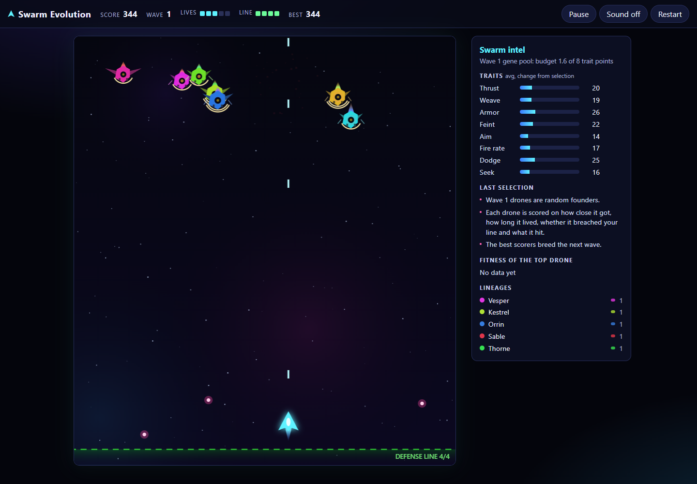

# Swarm Evolution

An arcade shooter where the enemies breed. Every drone carries eight inherited traits. When a wave ends, each drone is scored on what it actually did against you, and the best performers become parents of the next wave. The intel panel shows what was selected and why.

No build step, no dependencies, no external requests. Plain JavaScript modules, HTML and CSS, with procedural canvas art and optional Web Audio sound.



## Play

Use Python 3.11 or newer and a current browser. Node.js 24 is needed only for the tests and balance tool.

```sh
python server.py            # then open http://127.0.0.1:8000/
python server.py --port 8123
```

| Action  | Keyboard                         | Touch / mouse                   |
|---------|----------------------------------|---------------------------------|
| Move    | Arrow keys or A / D              | Drag on the play field          |
| Fire    | Space (hold), also J, Z, W, Up   | Fires while your finger is down |
| Pause   | P or Esc                         | Pause button                    |
| Sound   | M (off until you turn it on)     | Sound button                    |
| Restart | R                                | Restart button                  |
| Intel   | I                                | Intel button on small screens   |

Optional URL parameters: `?seed=abc` fixes the starting swarm and keeps that seed on restart. The same seed and inputs replay identically; later waves depend on how you play. `?mode=control` swaps evolution for random traits at the same budget.

Choose **Campaign** (12 waves), **Long campaign** (24 waves), or **Endless** before Launch or Restart. Changing the selector during play takes effect on Restart. Endless exposes the original unlimited survival game; the two campaigns add a finishing point without changing the shared wave rules. Trait budgets and swarm size still cap, while selection continues to respond to your play. `?run=campaign`, `?run=extended` and `?run=endless` select the starting option.

Press Sound or M to enable sound. A brief confirmation tone plays even on the title screen. The status reports blocked or unavailable audio and allows a retry. If it says enabled but you hear nothing, check the browser tab, app and device volume. Browser audio state and offline waveform tests cannot establish physical audibility.

Play pauses when the tab is hidden or the game window loses focus. Return and press Resume when ready. Releasing a held fire key after pausing leaves the pause panel open.

## How the swarm evolves

**Traits** (each 0 to 1): Thrust, Weave, Armor, Feint, Aim, Fire rate, Dodge, Seek. They map to bounded behaviour in `src/genome.js`. Armor also makes a bigger hull, so it carries a cost.

**Budget.** Every drone spends exactly the wave's trait budget: 1.6 points on wave 1, then 0.3 more per wave, capped at 4.4 of a possible 8. No drone can max everything, and difficulty comes from a number you can see. Swarm size grows by one drone per wave, capped at 18.

**Fitness** (`src/evolution.js`):

| Source   | Reward                                                        |
|----------|---------------------------------------------------------------|
| Approach | up to 40 for depth reached, plus 14 per second near your ship (capped) |
| Survival | 2 per second alive (capped at 25 s)                           |
| Breach   | 120 for crossing the defense line                             |
| Effect   | 90 per hit on you, 60 per ram, 8 per dodged shot, 6 per hit soaked by armor |

**Breeding.** The top 2 drones' trait allocations carry over, rescaled to the next wave's budget. Most of the wave comes from tournament selection (size 3), uniform crossover and Gaussian mutation. About 10% are fresh random newcomers, so the gene pool keeps some variety. Each drone records its parents and lineage. Selection uses this run's outcomes; it does not guarantee that every new wave will be harder.

Formation slots are shuffled each wave using a separate seeded stream, so elite drones and newcomers do not always inherit the same starting positions. Control mode uses the same slot permutation for a given seed and wave.

**Intel panel.** Shows average traits for the incoming wave and the selection differential: how far the chosen parents' average was from the whole wave's. It also shows a plain-language summary, the top drone's fitness sources, and lineage shares. Drone visuals reflect their genes: flame length for Thrust, wingspan for Weave, plating rings for Armor, eye brightness for Aim, barrels for Fire rate.

**Defense line.** Each breach costs one of 4 line segments. Losing the last segment costs a life and resets the line. Clearing a wave repairs one segment, and every 4th wave grants a life (up to 5).

## Tests and tools

```sh
node --test "tests/*.test.js"                              # engine, evolution, storage, static checks
python -m unittest discover -s tests -p "test_*.py"        # loopback server
node tools/balance.js 24 12                                # headless balance report (seeds, wave cap)
```

`tools/balance.js` pits two scripted pilots (casual and skilled) against evolving swarms and a random control. It reports normal-game survival separately from a pressure assay with extra lives, so early game overs do not remove difficult runs from late-wave comparisons. The assay keeps the same fitness, damage, budgets and formation rules. Bot results do not establish how a human will play.

The optional browser test checks keyboard and touch play, short-screen overlays, restart, game over and storage failures. In a disposable test environment, install `playwright@1.62.1`, run `npx playwright install chromium`, then `node tests/browser.cjs`. Screenshots go under the ignored `work/browser/` directory. Playwright is not a game dependency.

## Layout

```
index.html, styles.css, assets/icon.svg
src/rng.js        seeded PRNG
src/genome.js     traits, budget, mutation, crossover, phenotype
src/evolution.js  fitness, selection, breeding, reports
src/sim.js        deterministic fixed-step game simulation
src/loop.js       bounded fixed-step accumulator
src/render.js     canvas renderer (read-only view of the sim)
src/ui.js         HUD and intel panel (textContent only)
src/input.js      keyboard and pointer input
src/audio.js      opt-in procedural sound
src/storage.js    optional local best score
server.py         loopback-only allowlist static server
tests/, tools/
```

## Privacy and security

- No external requests, analytics, cookies, microphone or camera. A strict Content Security Policy blocks remote resources.
- Optional localStorage records contain only `{ v, best, wave }`, schema-checked and size-limited. Six fixed keys separate the three run modes and evolving/control rules. Older mixed-rule records remain visible as a separate legacy best and are preserved. It works with storage disabled.
- Sound starts only after you press the Sound button.
- The game pauses when the tab becomes hidden and waits for you to resume. Reduced-motion settings reduce cosmetic effects.
- `server.py` binds to 127.0.0.1, serves a fixed list of files, checks Host and Origin, and allows only GET and HEAD. It caps accepted connections at 16, headers at 16 KiB, each header line at 4 KiB, header duration at 5 seconds and assets at 1 MiB. It rejects linked assets and ambiguous requests, sends hardening headers on errors, and does not log request URLs. See [SECURITY.md](SECURITY.md).

## Feedback

[Suggest a change or report a problem](https://github.com/Jgolding1998/Jgolding1998/issues/new?template=feedback.yml). Mention `swarm-evolution`. Feedback is public, so leave out personal details, private files and credentials.

## License

MIT, see `LICENSE`.
